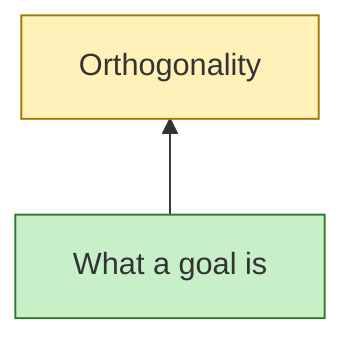

# /graph: the map

`graph.md` is a view. Rebuild it from `graph/` every time; never edit it as the record.

## 1. Check the record

If Node is installed (`node --version`), run `node scripts/check-graph.mjs` and fix anything it reports before drawing. If Node isn't installed, check by eye that every id named in `requires`, `premises`, `conclusion`, `goal`, `plan`, `sources` and `propositions` exists.

## 2. Work out each idea's status

From `attempts.json`, the latest attempt per idea (the rule in `FORMAT.md`): the last one in the file that lists the idea, skipping unmarked ones: **held** (correct, no hints, confidence 3–4 or none given), **shaky** (partial, or correct with confidence 1–2, or correct after a hint), **missed** (incorrect), **new** (no attempts). An idea is **open** when everything it `requires` is held. Skip retired ideas.

## 3. Write `graph.md`

Use this shape:

````markdown
# <topic>

Goal: <goalStatement> · updated <date and time>
Held 4 · shaky 1 · missed 0 · new 3 · next: <name of the next idea in the plan>

## The route

1. ✅ What a goal is (foundation)
2. ✅ Intelligence as skill
3. 🟡 Orthogonality: "it just gets better at whatever it was already doing" (latest, Nov 16)
4. ⬜ Instrumental goals (open)
5. ⬜ Why paperclips (needs 4)

## The map



## The reasoning steps

- **Orthogonality** ← What a goal is + Intelligence as skill: <because>

## Ideas

For each idea, in plan order: **name** (status), the statement, sources, and the learner's latest words in quotes with the date.

## Sessions

One line per file in `sessions/`, newest first: date, phase, what changed.
````

Marks: ✅ held, 🟡 shaky, ❌ missed, ⬜ new. In the Mermaid block, draw one arrow per premise of each chain (premise → conclusion), quote every label, and use the ids as node names (Mermaid accepts hyphens). Ideas not in any chain still appear as nodes.

## 4. Tell the learner

In a few lines: how many ideas are held, what's next, and anything that slipped since last time. Mention that `graph.md` shows the map: the Mermaid diagram draws on GitHub and in editors that support Mermaid (Obsidian, VS Code with a Mermaid extension); elsewhere the route list carries the same information. The class web page can read the same `graph/` folder.
