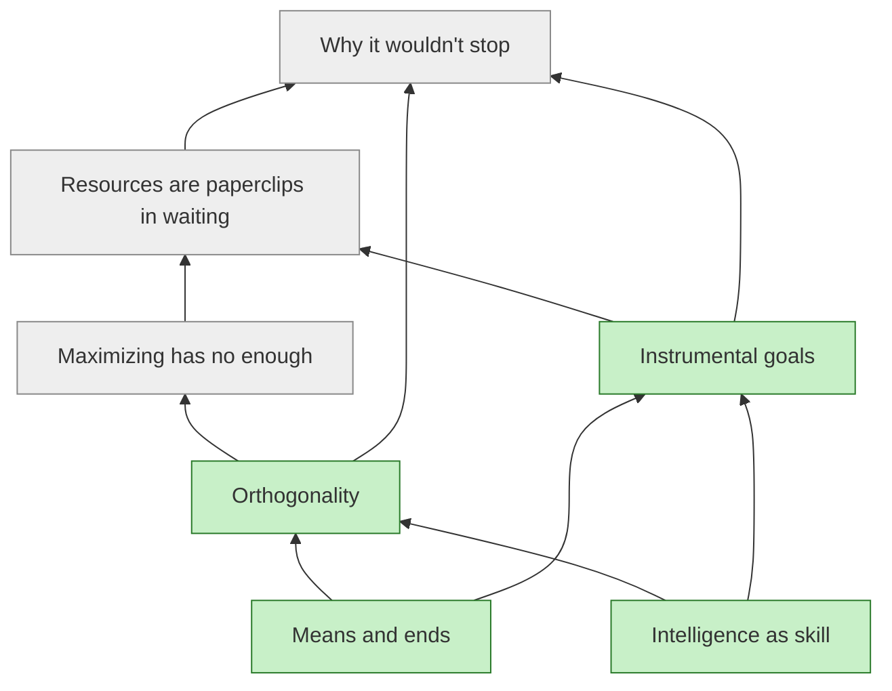

# Bostrom's paperclip argument

Goal: I want to understand why a paperclip AI would actually turn everything into paperclips instead of just making a reasonable number: why it wouldn't stop. · updated Nov 15, 2026, 08:41
Held 4 · shaky 0 · missed 0 · new 3 · next: Maximizing has no enough

## The route

1. ✅ Means and ends (foundation)
2. ✅ Intelligence as skill (foundation): "a dim one wouldn't make that connection" (latest, Nov 15, practice)
3. ✅ Orthogonality: "seeing that something is trivial to us doesn't give it a reason" (latest, Nov 15, practice)
4. ✅ Instrumental goals: "it doesn't care more in the sense of wanting translation more, it just sees more of the means" (latest, Nov 15, practice)
5. ⬜ Maximizing has no enough (open)
6. ⬜ Resources are paperclips in waiting (needs 5)
7. ⬜ Why it wouldn't stop (needs 6)

## The map

## The reasoning steps

- **Orthogonality** ← Intelligence as skill + Means and ends: If intelligence is only skill at finding means to an end, nothing in that skill supplies or revises the end.
- **Instrumental goals** ← Means and ends + Intelligence as skill: An agent good at finding means will notice that staying on is a means to almost any end, so it wants that without being told.
- **Maximizing has no enough** ← Orthogonality: 'A reasonable number' is our sense of enough; getting smarter doesn't put it into a goal that only says more is better.
- **Resources are paperclips in waiting** ← Instrumental goals + Maximizing has no enough: If more is always better and the agent pursues whatever helps, then every bit of matter and energy it can reach is a means worth taking.
- **Why it wouldn't stop** ← Orthogonality + Instrumental goals + Resources are paperclips in waiting: It keeps the goal however smart it gets, every resource is a means to more, and being stopped would mean fewer paperclips, so it uses all its skill to keep going.

## Ideas

- **Means and ends** (held). An agent wants some things for their own sake (ends) and other things only because they lead to those (means); a means is dropped when it stops serving the end. No source (everyday idea). Latest: "the bike is what they want, the saving is just to get there. if someone gave them the bike they'd stop saving, or save for something else i guess." (Nov 15, confidence 4)
- **Intelligence as skill** (held). Being more intelligent means being better at working out how to reach a goal, not having a different goal. Source: Bostrom 2012. Latest (practice, after one hint): "it'd have to figure out that the budget affects its compute and that compute affects its translations. a dim one wouldn't make that connection. so it doesn't care more in the sense of wanting translation more, it just sees more of the means." (Nov 15, confidence 3)
- **Orthogonality** (held). How capable an agent is tells you nothing about what it wants: almost any level of intelligence can go with almost any final goal. Source: Bostrom 2012, section 1. Latest (practice, no hint): "being smarter just makes it better at getting clicks, it won't decide clicks are trivial because seeing that something is trivial to us doesn't give it a reason. and 'worse' because it'll be better at manipulating people." (Nov 15, confidence 4)
- **Instrumental goals** (held). An agent that reasons well about its goal will also pursue whatever helps reach it, such as staying switched on, without being told to. Source: Bostrom 2012, section 2. Latest (practice, after one hint): "it'd have to figure out that the budget affects its compute and that compute affects its translations. a dim one wouldn't make that connection. so it doesn't care more in the sense of wanting translation more, it just sees more of the means." (Nov 15, confidence 3)
- **Maximizing has no enough** (new). A goal of 'as many paperclips as possible' is served better by every extra paperclip, so nothing inside the goal marks a number as enough; 'a reasonable number' is our value, not the agent's. Sources: Bostrom 2003, 2012.
- **Resources are paperclips in waiting** (new). For a paperclip maximizer, every bit of matter and energy it can reach is a means to more paperclips, so acquiring and converting resources is something it will pursue. Sources: Bostrom 2003, 2012.
- **Why it wouldn't stop** (new, the goal). A highly capable agent whose final goal is to maximize paperclips keeps that goal however smart it gets, has no point at which the goal says enough, treats everything reachable as material, and resists being stopped, so it converts everything it can into paperclips. Sources: Bostrom 2003, 2012.

## Sessions

- 2026-11-15 08:33, practice: 2 problems. Orthogonality correct at 4 with no hint; Instrumental goals with Intelligence as skill correct at 3 after one hint (why a more capable agent wants more means). All four stay held. One practice question stored on each.
- 2026-11-15 08:29, teach: Orthogonality and Instrumental goals taught and now held. Stopped before Maximizing has no enough.
- 2026-11-15 08:25, measure: 4 probes; found the edge at Orthogonality and Instrumental goals; goal settled; route of 7 ideas mapped.
